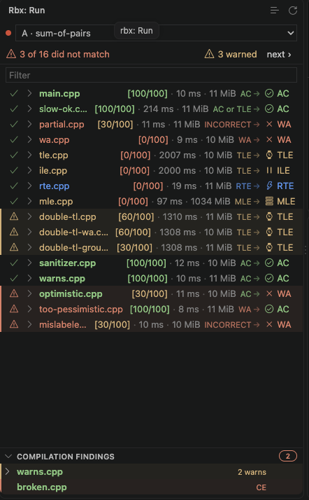
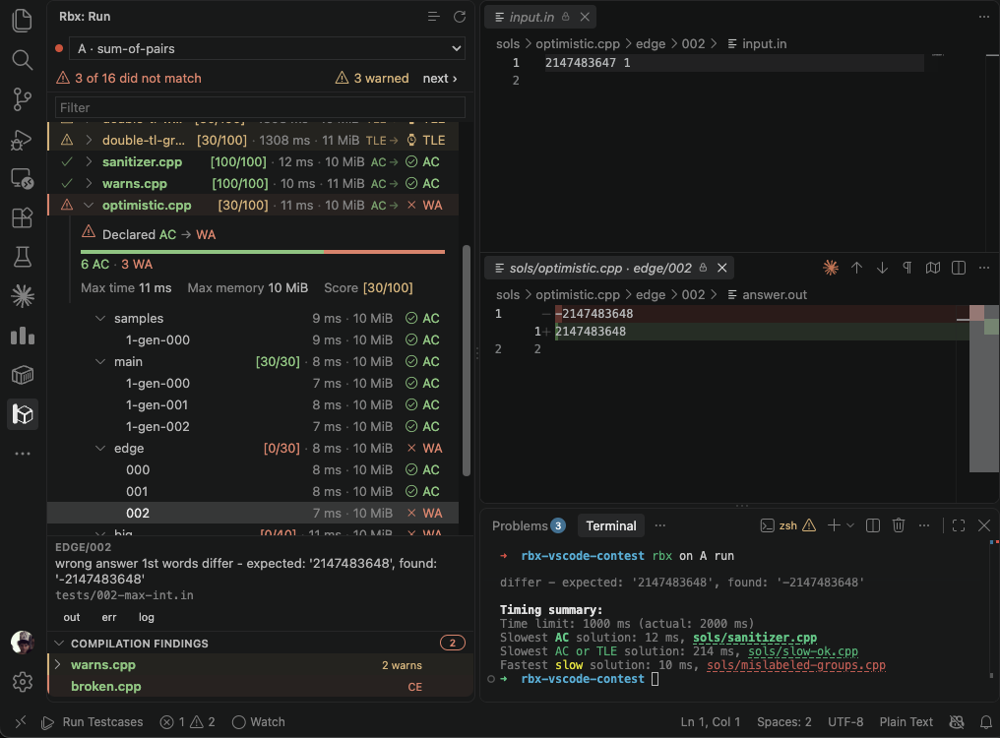
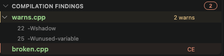
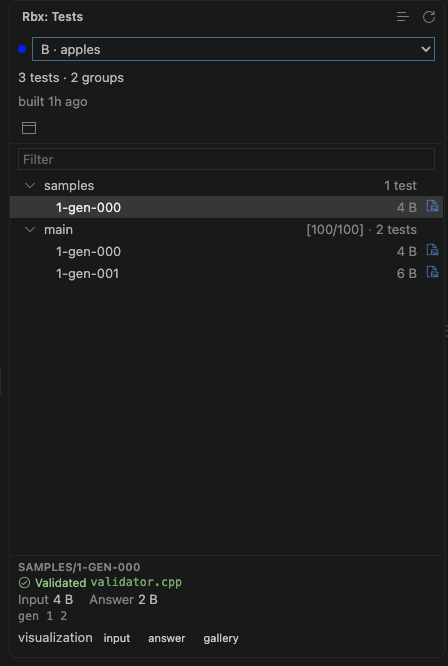
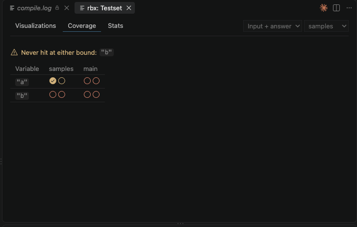
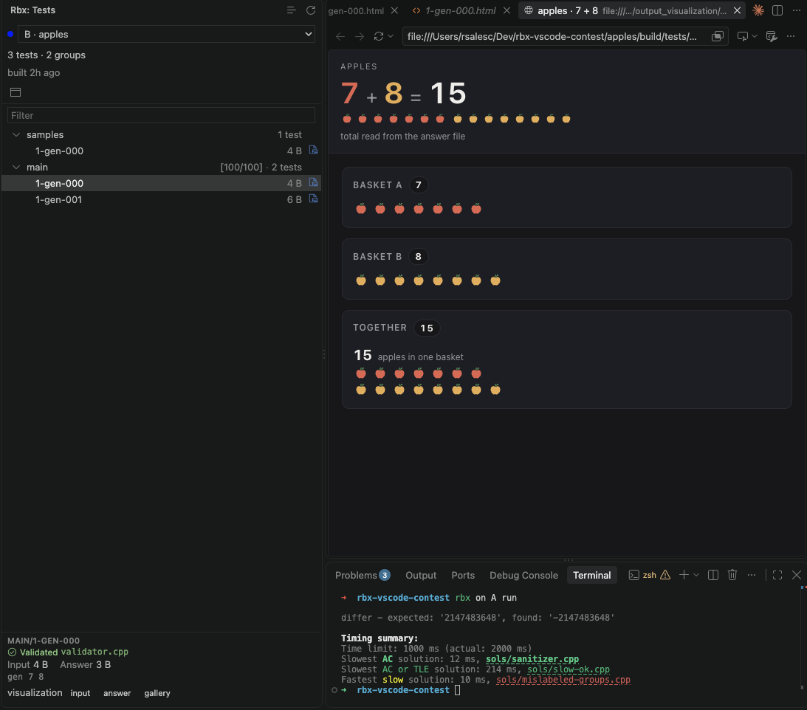

# rbx for VS Code

`rbx ui` is one way to inspect a run and the testset it ran against. The rbx
extension is another, for when the editor is where you already are: it reads
the same files from the same package, and shows them in the sidebar next to the
solution you are editing.

Which one you want is mostly a matter of where you work. The TUI runs anywhere
a terminal does, and does not care which editor you use; the extension gives
you VS Code's own diff, its editors and its Problems panel, and it does not
take over the terminal you are typing `rbx` into.

!!! note "It never builds or runs behind your back"
    Execution stays in a terminal. You type `rbx run`, or press a button that
    runs the same command in a terminal you can see and interrupt, and the
    extension shows what the command writes into the package. It does call {{rbx}} itself
    for a few small things -- drawing a visualization, asking what a
    variable expands to, listing the groups a stress finding can go to and
    previewing a testplan change -- and for those it has to find an `rbx` to call, which
    [Finding rbx](#finding-rbx) covers.

## Installing

From the editor's integrated terminal:

```bash
rbx vscode install
```

That sideloads the `.vsix` bundled with your {{rbx}}, so the extension always
matches the CLI that produced the runs it reads. **Reload the window
afterwards** -- a freshly installed extension does not activate in windows that
are already open.

Cursor, Windsurf and VSCodium work the same way: they all report themselves as
VS Code, and {{rbx}} tells them apart by which app the terminal belongs to. Pass
`--editor` if it guesses wrong, which is also how you install from a terminal
outside the editor.

```bash
rbx vscode install --editor cursor
```

Over SSH or in a devcontainer this installs into the *remote* extension host,
which is the right place -- that is where your package lives.

The extension is not published on any marketplace. When your {{rbx}} ships a
newer extension than the one you have installed, `rbx run` says so once and
points you back at this command.

## The run view

The **rbx** icon in the activity bar opens the run view: solution, group,
testcase, filled in live as `rbx run` works through them.



Three different things can be true of a solution at once, and the view keeps
them in three separate places so they cannot be mistaken for one another:

| Channel | Says |
|---|---|
| the **name**, coloured | what `problem.rbx.yml` *declared* -- exactly as `rbx run` colours the same name |
| the **chip** on the right | what the run actually *produced*, one icon per verdict |
| the **gutter** on the left | whether those two agree: a tick when the declaration was met, a red triangle when it was missed, a yellow one when {{rbx}} warned about a run that still passed |

So `sols/wa.cpp` answering wrongly is a calm row, and the main solution breaking
is not -- a miss is the only thing in the view with a background colour.

Every solution and every group carries its own summary: the verdict underneath
it, the points it earned, and the **max** time and memory across its testcases.
A solution still running shows how far it has got (`12/40`) instead of a
verdict.

The header lists the limits each language ran under, the ones `rbx run` prints
before it starts, and names the [limits profile](../setters/profiling/profiles.md)
they came from, if any. `2×TL` there means each solution could keep running up
to twice the time limit before {{rbx}} stopped it.

A solution that went past the limit but finished within twice the limit is
still reported `TLE`, and its answer is still checked. When {{rbx}} suspects the limits aren't tuned to this machine,
the header shows a `limits look untuned` notice. Run
[`rbx time`](../setters/profiling/estimating.md) to estimate them.

When {{rbx}} stopped a testcase at twice the limit, its row shows only when it
stopped it, like `>2000 ms`, the way `rbx run` prints it.

Hover a time to see the time limit it's compared with: the limit of the
solution's own language, so a Python solution's times are compared with the
Python limit.

In a contest, a dropdown in the header picks which problem you are looking at,
naming problems by their contest letter and colour. It follows the problem that
is *running*, so `rbx contest each run` walks the view along with it. The
dropdown is hidden entirely when the workspace holds a single package.

A contest split into variants gets one block per variant, headed by the variant
id. The extension never learns which variant you passed to `-C`, so it offers
all of them at once: the canonical contest's problems first, then each variant's
under its own heading. Two divisions that both start at `A` stay apart, and the
heading says which `A` you are about to open.

## Opening a testcase

<kbd>Enter</kbd> on a testcase -- or a click on it -- opens **two editor
panes**: the input, and the output diffed against the expected answer.



Under the tree, a card describes the selected testcase and shows what its row
can't fit:

- **the checker's own message**, wrapped and whole -- the answer to *why* a
  solution answered wrongly;
- **where the test came from** -- the generator call, the generator script, or
  the testcase it was copied from, with the ones that point at a real file
  opening it;
- **the other times** -- the solution's wall-clock time (the row shows CPU
  time), and the checker's and interactor's times when they ran.

The card's `out`, `err` and `log` buttons pick what the second pane shows: the
output against the expected answer, what the solution wrote to stderr, or the
run log for that testcase. The choice is sticky, so arrowing down a group keeps
reading the same channel.

The panes are laid out once, the first time a testcase is opened, and then left
alone; afterwards the extension finds its own panes and reuses whichever groups
they are sitting in. Drag them where you want them and they stay there.

## Compilation findings

A solution that did not compile never ran, and {{rbx}} leaves it out of the run
entirely. Under the tree, a **Compilation Findings** panel keeps one row per
solution the compile phase had something to say about, badged red the moment one
failed to compile and yellow while everything merely warned.



A row with warnings expands into one line per warning -- its line and its flag,
`22 · -Wshadow` -- and clicking one goes to that line in the source. A row that
failed to compile opens the compiler output verbatim.

## Browsing the testset

The **Tests** view lists what `rbx build` produced: the groups, their testcases,
and where each one came from. Selecting a testcase opens its input and expected
answer, and its card names the validator that accepted it and the generator that
wrote it.



A panel opens beside it, following whatever the sidebar has selected, with:

- a **visualization gallery**, when your package declares a visualizer;
- **constraint coverage** -- which of your validator's bounds the testset
  actually hit, and which no test ever touched;
- **testset stats** -- sizes and counts, group by group.



### Visualizations

If your package declares a [visualizer](../setters/testset/visualizers.md), the
pictures `rbx build --visualize` produced are opened from here, the way
<kbd>v</kbd> opens them in `rbx ui`. Select a testcase and its card offers one
**visualization** button per picture that exists: `input` for the testcase
itself, `answer` for the one drawn
[from the expected
answer](../setters/testset/visualizers.md#input-vs-solution-visualizers), and
`gallery` for the whole group at once, in the panel.



An image opens in an editor tab; an interactive HTML one opens in VS Code's own
browser, beside the list you picked it from, rather than in whatever program
your desktop associates with the file.

!!! warning "Solution outputs are not visualized here"
    These are the pictures {{rbx}} draws from a testcase and its expected
    answer. Visualizing what a *solution* printed is not available in the
    extension yet -- use `rbx ui` for that.

## Stress testing

The **Stress** view is next to the run view and the **Tests** view. It starts
[stress tests](../setters/stress-testing.md) and shows what they find, read
from the files `rbx stress` writes, so a stress you start in a terminal shows
up there too.

At the top are the stresses declared in `problem.rbx.yml`, each with a button
that runs it and one that opens it in the [launcher](#the-stress-launcher).
While a stress runs, a status line counts the tests it ran and the findings so
far. The stop button ends a stress you started from the view. Unlike
<kbd>Ctrl</kbd>+<kbd>C</kbd>, it doesn't wait for the current test to finish,
and the findings so far are kept. A stress started in a terminal has to be
stopped from that terminal.

Each finding gets a row with the generator call that produced it, and a chip
per solution with its verdict on that test. From the row you can:

- **open** the input, with the expected answer and each solution's output
  beside it (a solution's stderr, when it isn't empty, is offered in a
  notification);
- **compare** the outputs of two solutions, in VS Code's diff;
- **copy** the generator call;
- **promote** the finding into the testset.

Promoting a finding first asks which group to add it to. For a group backed
by a testplan, it opens a diff of the testplan against the version {{rbx}}
proposes, with the new generator call. You can edit the proposed side, then
save it with the check-mark button (**Accept Proposed Change**) in the editor title. Promoting into a
testcase-glob group, or into a group that doesn't exist yet, runs
[`rbx testcases add-finding`](../setters/stress-testing.md#adding-findings-to-the-testset)
in a terminal.

### The stress launcher

The **New stress** button opens the launcher, a form in an editor tab that
builds an `rbx stress` command and shows it as you fill the form in. It has
three sections:

- **Inputs** -- a declared stress, a generator expression, or the test groups
  to fuzz.
- **Find** -- the finder, as rows joined by **All of** or **Any of**. A
  **Break** row matches a test where the solution you pick gets the verdict
  you pick, such as `INCORRECT`, and a **Disagree** row a test where two
  solutions get different verdicts. **Slowest
  tests** looks for the slowest tests instead.
- **Budget** -- how long to run, how many findings to stop after, and the time
  limit, with the rarer options under **Advanced**.

**Run** starts the stress in a terminal, and **Copy** copies the command
instead. When the form can't build a valid command, the footer says why and
**Run** stays off.

The rows cover the finders most stresses use. For anything they can't
express, write the finder expression yourself and run `rbx stress` in a
terminal, or [save it as a declared stress](../setters/stress-testing.md#saving-a-stress-test):
the launcher runs a declared finder as written.

## Variables in a statement

While you are editing a statement, every `\VAR{...}` that names one of the
package's [variables](../setters/variables.md) is followed by what that
variable expands to, so a constraints block reads as its numbers without
`problem.rbx.yml` open beside it.

```{.latex .no-copy}
\item $1 \le N \le \VAR{N.max}$    100000
\item $1 \le a_i \le \VAR{A.max}$  1000000000
```

The greyed numbers on the right are not in the file: they are VS Code's own
**inlay hints**, which means `editor.inlayHints.enabled` turns them off along
with every other extension's, and `rbx.statementVarHints` turns off just these.

The values come from `rbx vars`, which only reads `problem.rbx.yml` -- so they
are right while you type, and do not wait for a `rbx build` or a
`rbx statements build`.

A reference piped through a
[filter](../setters/statements/context.md#filters) is hinted as what the filter
makes of it, not as the bare number underneath. {{rbx}} renders the expression
itself, so the hint agrees with the statement whatever you pipe through --
`sci`, `rsci`, or any {{Jinja2}} builtin such as `upper` or `round(2)`:

```{.latex .no-copy}
\item $1 \le N \le \VAR{N.max | sci}$      10⁵
\item $1 \le a_i \le \VAR{A.max | sci}$    10⁹
\item Answers modulo \VAR{MOD | rsci}      10⁹ + 7
```

An inlay hint cannot typeset maths, so it spells the same value in plain text:
superscript digits and `×` where the built statement gets `^{}` and `\times`.
Only the spelling changes. What a filter *decides* is the same in both places,
so `sci` leaving `250000` as its digits in the PDF leaves it as its digits in
the hint too.

A reference to a
[test group's own variables](../setters/statements/context.md#building-a-subtasks-table-from-testgroup-vars)
is hinted too, as long as it names the group:

```{.latex .no-copy}
\item In subtask 1, $N \le \VAR{problem.groups.sub1.vars.N.max}$    10
```

The value is that group's *resolved* set -- the package variables with the
group's overrides applied -- so a name the group does not override is hinted
with the value it inherits, exactly as it renders. The shorthand
`\VAR{problem.groups.sub1.N.max}` is hinted the same way, and a group whose name
holds a dash is reached the only way {{Jinja2}} can reach it, as
`\VAR{problem.groups['sub-1'].N.max}`.

A hint is shown only where it can be exactly right, and there are three places
it deliberately is not:

- **Only a group you name.** A reference like `\VAR{g.N.max}` inside a
  `\BLOCK{for g in groups}` loop renders a different number per group, so one
  hint on one line would have to lie or to pick a group; it gets nothing. This
  is worth knowing because the loop is how a subtasks table is usually written
  -- the table stays unhinted, while a constraint that names its group does
  not. `\VAR{p.N.max}`, `\VAR{problem.title}` and `\VAR{contest.year}` resolve
  against variable sets that are not this problem's own, and get nothing
  either.
- **Nothing is ever guessed.** A name no variable answers to, an expression
  that is not a plain dotted name, a commented-out line, an escaped `\\VAR` --
  all get nothing, and neither does a half-typed pipeline like
  `\VAR{N.max |}`. A filter over a name that does not exist gets nothing
  either: the name is looked up before anything is rendered, so a typo never
  costs a render. An absent hint is never a wrong one, and it is a useful
  tell: a misspelled variable is the one reference on the line with no number
  next to it.
- **Only what the manifest calls a statement.** `problem.rbx.yml`'s
  `statements` and `tutorials` are hinted. A contest statement declared in
  `contest.rbx.yml`, and the LaTeX template a statement is rendered into, are
  not -- they are not problem statements, and their variables are not this
  package's.

## Previewing a statement

While you edit a statement, you can keep its PDF open in a panel beside it.
Open a statement source and click the preview button in the editor's title bar,
or run the **Open Statement Preview** command from the command palette.

The panel shows what `rbx statements build` last produced, and reloads every
time a build writes a new one, including a build you typed in a terminal
yourself.

The panel's **Build** button rebuilds what is on screen, in a terminal of its
own. For a tutorial that's `rbx tutorials build`, and for the contest's
statement it's the `rbx contest` form of the same command. A rebuild keeps your page and
your zoom, so you can fix a sentence on page three and watch page three change.

A package can have several statements: one per language, a tutorial, a
variant, and the statement of the contest the problem is in. A picker at the
top of the panel switches between them. It starts on the one built from the
file you are editing, and follows you when you switch to another statement's
source.

To rebuild on every save instead of pressing **Build**, turn on
`rbx.statements.buildOnSave`. It's off by default, because a statement build
also builds the samples it shows, which can run your generators and your main
solution.

### Errors on the right line

When a build fails, the Problems panel shows each error on the line of the
file you wrote: the `.rbx.tex`, or the template {{rbx}} renders it into. It
never points at the `statement.tex` that {{rbx}} generates and you never edit.
That covers both kinds of mistake a statement build can hit:

- a **LaTeX error**, such as an undefined command or a missing `$`
- a **template error**, such as a `\VAR{...}` naming a variable that doesn't
  exist, or an unclosed `%- for`

An error {{rbx}} can't trace to a line, such as one inside a LaTeX package,
shows on the first line of the statement source.

The terminal prints the same errors in `file:line` form, so a build you run by
hand points at the same lines, and VS Code's terminal turns each one into a
link to its line:

```{.text .no-copy}
statement/statement-en.rbx.tex:3: Undefined control sequence.
```

The preview keeps showing the last PDF that did build, under a banner that
lists what went wrong. Clicking an entry opens the source at that line, and
**Log** opens the full output of `pdflatex` for anything the summary leaves out.

## Finding rbx

Drawing a visualization and reading a statement's variables both call {{rbx}},
so the extension has to find one. It tries `PATH` first and then asks a login
shell, because the extension host inherits the `PATH` of whatever launched VS
Code -- open the editor from Finder or the Dock rather than from a terminal and
that `PATH` is a bare one, without the `~/.local/bin` that `uv tool install`
and `pipx` write into.

If neither finds it, point `rbx.executable` at the binary. The setting is
per-folder, so a workspace holding packages on different {{rbx}} versions can
give each one its own.

Everything else keeps working without an `rbx` to call: the views read files.

## Settings

Every surface above can be turned off or adjusted on its own. Search for
`@ext:rsalesc.rbx-vscode` in VS Code's settings to see all of them, these included.

| Setting | Default | Does |
|---|---|---|
| `rbx.compilationDiagnostics` | `true` | Report compiler warnings and failures in the Problems panel |
| `rbx.statementVarHints` | `true` | Show what each `\VAR{...}` in a statement expands to, beside the reference |
| `rbx.statementDiagnostics` | `true` | Report the errors of the last statement build in the Problems panel |
| `rbx.statements.buildOnSave` | `false` | Rebuild a statement whenever you save its source or a file beside it |
| `rbx.executable` | *(empty)* | The `rbx` to call, when finding it automatically does not work |
| `rbx.solutionLabel` | `trimmed` | How much of a solution's path the run view shows: `full`, `trimmed` or `basename` |
| `rbx.testcaseLayout` | `below` | Where the second testcase pane is *first* placed: `below` or `beside` |
